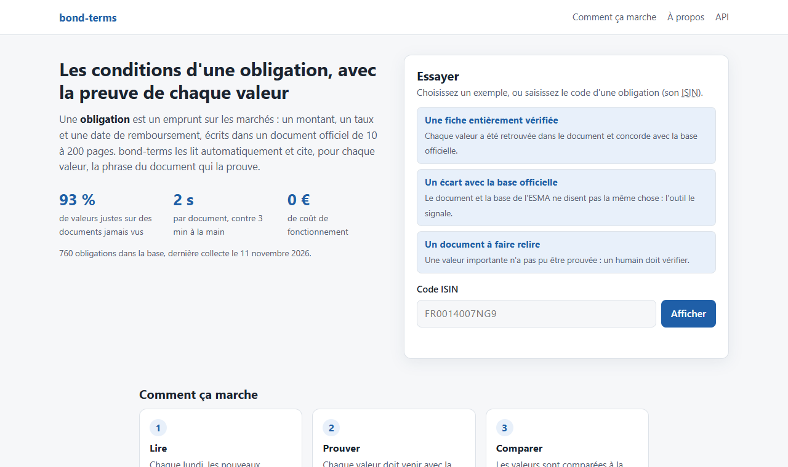
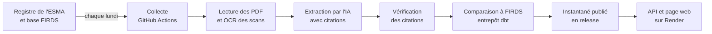

# bond-terms

[](https://github.com/mangnathan/bond-terms/actions/workflows/ci.yml)
[](LICENSE)

**Lire les conditions d'une obligation dans son document officiel, avec la preuve de chaque valeur.**

**[Essayer l'outil en ligne : bond-terms.onrender.com](https://bond-terms.onrender.com)** (hébergement gratuit : si personne ne l'a ouvert depuis un quart d'heure, la première réponse prend environ une minute).

[](https://bond-terms.onrender.com)

## Le problème

Quand une entreprise, une banque ou un État emprunte sur les marchés, il émet une **obligation** : un titre de dette avec un montant, un taux d'intérêt et une date de remboursement. Ces conditions sont écrites dans un document officiel de 10 à 200 pages, publié dans le registre de l'autorité européenne des marchés financiers (ESMA).

Dans une banque ou une société de gestion, l'équipe qui tient la base des titres recopie ces conditions à la main, ou les achète à un fournisseur sans voir d'où vient chaque valeur. J'ai chronométré cette saisie sur dix documents : **3 minutes par document**, et environ **une valeur sur sept fausse**.

## Ce que fait bond-terms

- **Il lit** chaque document avec une IA (Gemini) et en tire les conditions : devise, montant, valeur nominale, échéance, type de taux, taux, référence et marge d'un taux variable, rang de la dette.
- **Il prouve** chaque valeur : l'IA doit citer la phrase exacte du document, et le programme vérifie qu'elle s'y trouve et qu'elle écrit bien la valeur. Sans preuve, la valeur est refusée.
- **Il contrôle la base officielle** : chaque valeur est comparée à FIRDS, la base de référence de l'ESMA, et les écarts sont signalés.
- **Il sait quand il doute** : un document dont une valeur importante n'est pas prouvée part en relecture humaine.
- **Il va au-delà de FIRDS** : il lit aussi le droit de l'émetteur de rembourser avant l'échéance, que la base officielle ne contient pas.
- **Il se tient à jour** : chaque lundi, les nouveaux documents des 840 obligations suivies sont collectés, lus et publiés, sans intervention.
- **Il ne coûte rien** : offres gratuites uniquement, avec des plafonds inscrits dans le code.

## Résultats

Mesurés sur un jeu de **117 documents jamais vus** pendant la mise au point, ouvert une seule fois, avec des seuils fixés avant de mesurer :

| | bond-terms (IA) | Règles écrites à la main | Saisie manuelle |
|---|---|---|---|
| Valeurs justes | **93,2 %** [91,0 ; 95,2] | 67,6 % | 85,5 % (10 documents) |
| Temps par document | 2 secondes | moins d'une seconde | 3 minutes |
| Documents envoyés en relecture humaine | 19,7 %, qui contiennent 79 % des documents erronés | | |

- **Temps humain** : au moins **80 % économisé**. Seuls les documents signalés sont relus, et relire une fiche dont chaque valeur est citée ne prend pas plus de temps que la saisir.
- **Par champ** : la devise (100 %) et la valeur nominale (99,2 %) atteignent leur seuil de 98 % et 95 %. L'échéance et le type de taux (95,8 %), le taux fixe (93,1 %) et le rang (88,7 %) restent en dessous ; les taux variables sont trop peu nombreux dans le jeu (16 titres) pour conclure.
- **Écarts avec FIRDS** : 16 dans 15 documents, surtout des montants. Le document annonce le montant émis, et FIRDS l'encours réellement placé.

La saisie manuelle est comparée sur les mêmes champs que l'outil. Le détail de chaque mesure est dans le [rapport final (PDF)](docs/pdf/bond-terms_v1.0_Rapport-final.pdf), et un résumé d'une page dans la [note de synthèse (PDF)](docs/pdf/bond-terms_v1.0_Note-de-synthese.pdf).

## Comment ça marche



1. **Collecte.** La publication de FIRDS de la semaine donne les obligations suivies (huit émetteurs français : BNP Paribas, Société Générale, Crédit Agricole, BPCE, AXA, LVMH, Kering, Air France-KLM). Le registre de l'ESMA donne leurs documents ; seuls les nouveaux sont traités.
2. **Lecture.** Le texte de chaque PDF est extrait, et les pages scannées passent par une reconnaissance de caractères locale. Un contrôle vérifie que le document cite bien l'obligation, et écarte les produits structurés que FIRDS déclare comme des obligations classiques.
3. **Extraction et preuve.** L'IA renvoie chaque valeur avec sa citation. Le programme retrouve la citation dans le document et vérifie qu'elle écrit la valeur : montant, taux et date compris. Si l'IA ne répond pas, un extracteur à règles prend le relais, et le document est relu par l'IA la semaine suivante.
4. **Comparaison et surveillance.** Les valeurs sont comparées à FIRDS par les mêmes modèles dbt que l'évaluation. La part de documents en revue, de valeurs refusées et d'écarts est suivie ; un seuil franchi ou une panne ouvre une issue GitHub.
5. **Publication.** Le résultat est publié en release GitHub. L'API le charge au démarrage, ne fait que le lire et n'appelle jamais l'IA : aucun visiteur ne peut consommer le quota gratuit.

## Méthode d'évaluation

- **Une vérité officielle** : les valeurs de FIRDS, publiées par l'ESMA, plutôt qu'une annotation faite à la main par un non-spécialiste.
- **Des seuils fixés avant de mesurer** : au moins 98 % pour la devise, l'échéance, le type de taux et le taux fixe ; 95 % pour les autres champs. L'IA n'est retenue que si elle bat un extracteur à règles d'au moins 2 points.
- **Quatre ouvertures de test**, chacune sur des documents jamais vus, tirés au hasard avec une graine fixée et figés avant tout téléchargement, ouverts une seule fois depuis un commit consigné dans un registre daté. Chaque réglage s'est fait sur les jeux déjà ouverts.
- **Des intervalles de confiance** à 95 % par bootstrap sur les documents, et une différence appariée entre l'IA et les règles.
- **Des décisions écrites** : chaque version a sa note de décision ([ADR](docs/adr)), avec ses précisions et son gel datés avant l'ouverture du test.

## Limites

- Deux champs sur les neuf qui ont un seuil l'atteignent (devise, valeur nominale), et les taux variables sont trop peu nombreux pour être jugés.
- Le montant n'est comparé qu'à titre indicatif : FIRDS publie l'encours, le document le montant émis.
- La lecture du remboursement anticipé au gré de l'émetteur est indicative : FIRDS ne la contient pas, aucune base officielle ne permet de la mesurer.
- Le contrôle des produits structurés repose sur le libellé du document et laisse passer certains cas (« Autocall »).
- L'IA gratuite refuse ponctuellement un document par surcharge, et ses réponses varient légèrement d'une exécution à l'autre.
- La saisie manuelle de référence porte sur dix documents, saisis par une seule personne non spécialiste.

## Historique des versions

| Version | Contenu | Rapport |
|---|---|---|
| v0.0 | Cadrage : population, vérité terrain, seuils, saisie manuelle chronométrée | [PDF](docs/pdf/bond-terms_v0.0_Rapport-de-cadrage.pdf) |
| v0.1 | Collecte (FIRDS, registre, PDF) et entrepôt de données dbt | [PDF](docs/pdf/bond-terms_v0.1_Rapport-de-collecte.pdf) |
| v0.2 | Extracteur à règles contre IA, premier test ouvert une seule fois | [PDF](docs/pdf/bond-terms_v0.2_Rapport-extraction.pdf) |
| v0.3 | Relecture humaine, rapport d'écarts avec FIRDS, deuxième test | [PDF](docs/pdf/bond-terms_v0.3_Rapport-revue-exceptions.pdf) |
| v0.4 | Collecte hebdomadaire, surveillance et alertes, API en ligne, troisième test | [PDF](docs/pdf/bond-terms_v0.4_Rapport-service.pdf) |
| v1.0 | Vérification des taux et des dates, clause hors FIRDS, page de démonstration, quatrième test | [PDF](docs/pdf/bond-terms_v1.0_Rapport-final.pdf) |

Le détail des changements est dans le [CHANGELOG](CHANGELOG.md).

## Technique

Python 3.12, uv, DuckDB et dbt (entrepôt, aussi testé sur le bac à sable BigQuery), pypdf et RapidOCR, Gemini (offre gratuite) pour l'extraction, FastAPI pour l'API, GitHub Actions pour la CI et la collecte, Render pour l'hébergement. Le code est typé (mypy strict), vérifié par ruff et couvert par près de 300 tests ; la CI bloque toute fusion qui ne passe pas.

## Lancer le projet

Prérequis : Python 3.12 et [uv](https://docs.astral.sh/uv/). Les rapports se compilent avec [Tectonic](https://tectonic-typesetting.github.io).

```bash
uv sync
uv run pytest

# Instantané des conditions extraites, puis API et page web sur http://localhost:8000
uv run python -m bond_terms.instantane
uv run uvicorn bond_terms.api:app --no-access-log
```

L'extraction par l'IA demande une clé de l'API Gemini, créée dans AI Studio sur un projet sans facturation liée, dans un fichier `.env` jamais versionné (voir [.env.example](.env.example)).

<details>
<summary>Reproduire chaque étape (collecte, entrepôt, extraction, évaluation, service)</summary>

```bash
# Étude de faisabilité (les données téléchargées vont dans data/, jamais versionné)
uv run python scripts/feasibility/build_firds_debt_index.py --date 2026-10-17   # environ 20 minutes
uv run python scripts/feasibility/measure_register_match.py
uv run python scripts/feasibility/check_issuer_coverage.py
uv run python scripts/feasibility/compare_timing_to_firds.py

# Collecte (v0.1) : requêtes vers l'ESMA espacées d'une seconde et mises en cache
uv run python -m bond_terms.firds --date 2026-10-17                  # environ 3 minutes
uv run python -m bond_terms.registre --firds-date 2026-10-17         # environ 15 minutes
uv run python -m bond_terms.decoupage --firds-date 2026-10-17 --registre-date 2026-10-23
uv run python -m bond_terms.documents                                # environ 600 PDF

# Entrepôt de données sur DuckDB
uv run python -m bond_terms.entrepot --firds-date 2026-10-17 --registre-date 2026-10-23
uv run dbt build --project-dir entrepot --profiles-dir entrepot

# OCR des pages sans texte, puis contrôle « le document cite l'ISIN »
uv run --group ocr python -m bond_terms.ocr
uv run python -m bond_terms.rattachement

# Extracteurs, évaluation, file de revue et écarts avec FIRDS (le cache évite tout second envoi)
uv run python -m bond_terms.lancement --extracteur regles --jeu test
uv run --group llm --env-file .env python -m bond_terms.lancement --extracteur llm --modele gemini-3.5-flash-lite --jeu test
uv run python -m bond_terms.evaluation
uv run python -m bond_terms.revue
uv run python -m bond_terms.exceptions

# Collecte hebdomadaire, comme le workflow du lundi
uv run --group ocr --group llm --env-file .env python -m bond_terms.collecte --precedent data/instantane/instantane.json

# Rapports
uv run python scripts/docs/build_report_pdf.py docs/v1.0-publique/v1.0-rapport-final.tex docs/pdf/bond-terms_v1.0_Rapport-final.pdf
```

Les jeux de test ont été tirés par `bond_terms.nouveau_test` et ouverts une seule fois par `bond_terms.ouverture` ; les deux commandes refusent d'être relancées. Le découpage et les jeux figés sont versionnés dans `docs/` : relancer la collecte un autre jour donnerait un autre registre, mais ne remplace pas ce qui a été figé.

Le même entrepôt tourne sur le [bac à sable BigQuery](https://cloud.google.com/bigquery/docs/sandbox), sans moyen de paiement, avec un compte de service dont la clé reste hors du dépôt :

```bash
uv run --group bigquery --env-file .env python -m bond_terms.bigquery
uv run --group bigquery --env-file .env dbt build --project-dir entrepot --profiles-dir entrepot --target bigquery
```

</details>

### Service en ligne

| Route | Contenu |
|---|---|
| `GET /` | Page de démonstration, lisible sans connaître le sujet |
| `GET /v1/obligations/{isin}` | Pour chaque document de l'obligation : extracteur, valeurs avec leur citation, leur page et leur statut, relecture, écarts avec FIRDS |
| `GET /v1/indicateurs` | Indicateurs de surveillance par jeu |
| `GET /v1/sante` | État du service, date de la dernière collecte, versions des extracteurs |
| `GET /docs` | Documentation interactive de l'API |

L'API vérifie le format et la clé de contrôle de l'ISIN avant toute recherche, limite chaque client à 60 appels par minute (600 au total), envoie les en-têtes de sécurité usuels et n'enregistre pas l'adresse des visiteurs. Le service est décrit dans [render.yaml](render.yaml) ; la collecte du lundi dans [collecte.yml](.github/workflows/collecte.yml).

## Structure du dépôt

```
src/bond_terms/          code : collecte, lecture, entrepôt, extracteurs, vérification, évaluation,
                         revue, écarts, collecte hebdomadaire, surveillance, API
src/bond_terms/demo/     page de démonstration (HTML, CSS, JavaScript, sans bibliothèque externe)
entrepot/                projet dbt : modèles, tests de données, profils DuckDB et BigQuery
scripts/                 étude de faisabilité, mesures des ADR, compilation des rapports
tests/                   tests unitaires et construction de l'entrepôt sur des données fabriquées
docs/adr/                notes de décision, une par version
docs/v0.0-cadrage/ ...   un dossier par version : rapport LaTeX et chiffres produits
docs/v1.0-publique/      quatrième test figé, résultats, mesures et business case
docs/pdf/                rapports compilés
.github/workflows/       CI et collecte hebdomadaire
render.yaml              description du service hébergé
```

## Données

Le projet utilise uniquement des données publiques :

- **ESMA** (Autorité européenne des marchés financiers) : la base de référence des instruments financiers FIRDS et le registre des prospectus. Source : ESMA, reproduction autorisée avec mention de la source ([mentions légales](https://www.esma.europa.eu/legal-notice)). Le dépôt ne contient aucun document de l'ESMA : seulement des identifiants (ISIN, liens) et des chiffres calculés à partir de ces bases. Les citations servies par l'API sont de courts extraits des documents publics.
- **GLEIF** (Global Legal Entity Identifier Foundation) : les identifiants LEI des émetteurs, publiés sous licence CC0 ([conditions d'utilisation](https://www.gleif.org/en/meta/lei-data-terms-of-use)).

Ce projet est indépendant : il n'est ni soutenu ni validé par l'ESMA ou GLEIF. Les valeurs sont lues automatiquement et peuvent contenir des erreurs : elles ne constituent pas un conseil en investissement.

## Auteur et licence

Projet personnel de Nathan Mang. Code sous licence [MIT](LICENSE).
